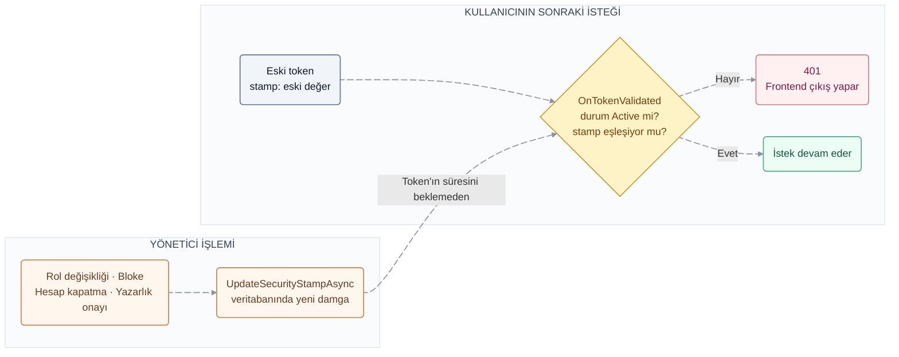
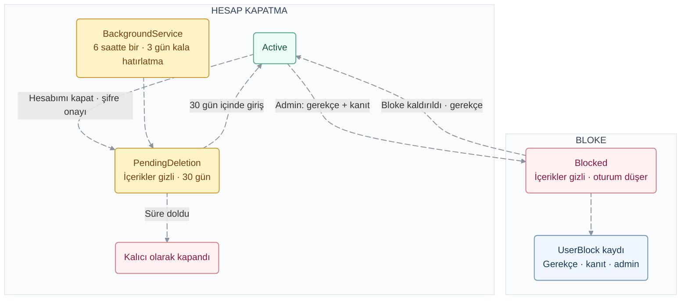
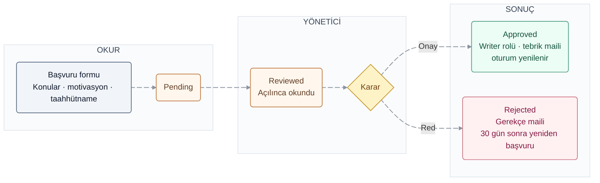
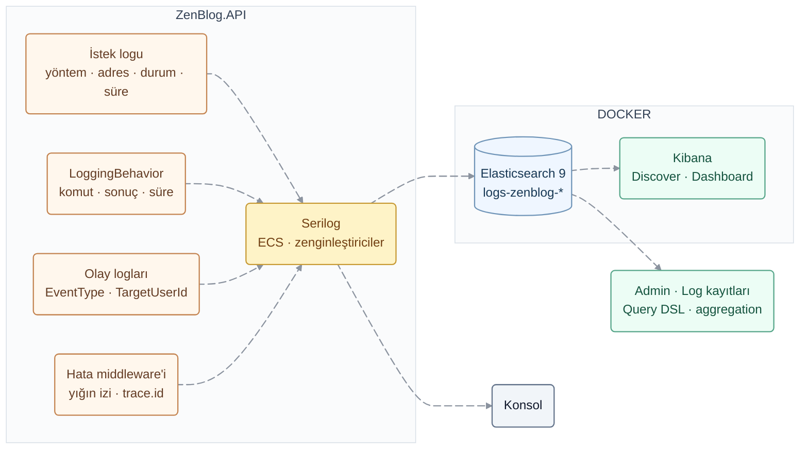

<div align="center">

# 🌿 ZenBlog

### Çok Rollü, Güvenlik Odaklı Blog Platformu


<p align="center">
  <strong>Okurdan yazara, yazardan yöneticiye: rol bazlı paneller, güvenli hesap yaşam döngüsü ve gözlemlenebilir bir altyapı.</strong>
</p>
<p align="center">
  <i>.NET 9 Minimal API · Clean Architecture · CQRS · JWT + SecurityStamp · Rate Limiting · Cloudflare Turnstile<br>
  Serilog + Elasticsearch + Kibana · Angular 20 + PrimeNG ile üç panel ve ziyaretçi sitesi</i>
</p>

<p align="center">
  <a href="https://github.com/KULLANICI_ADIN/ZenBlogBackend"><b>⚙️ Backend (bu depo)</b></a>
  &nbsp;·&nbsp;
  <a href="https://github.com/KULLANICI_ADIN/ZenBlogFrontend"><b>🎨 Frontend deposu</b></a>
</p>

</div>

---

**ZenBlog**, okurların yazıları okuyup yorum yaptığı, yazarların içerik ürettiği ve yöneticilerin bütün sistemi denetlediği **çok rollü bir blog platformudur**. Proje iki parçadan oluşur: **.NET 9 Minimal API** ile yazılmış, Clean Architecture prensiplerine göre katmanlandırılmış bir backend ve **Angular 20 + PrimeNG** ile geliştirilmiş, üç ayrı panel ve bir ziyaretçi sitesi içeren bir frontend.

Projenin odağında **güvenlik ve hesap yönetimi** vardır. Rol değiştiğinde ya da hesap bloke edildiğinde kişinin oturumu **anında** düşer. Hesap kapatma 30 günlük, geri alınabilir bir süreçtir. Bloke işlemleri gerekçe ve kanıt dosyasıyla kayıt altına alınır. Yazarlık bir başvuru ve değerlendirme sürecinden geçer. İçerik sahipliği backend'de, her istekte denetlenir.

Altyapı tarafında **Serilog ile yapılandırılmış loglama**, MediatR **pipeline behavior**'ları, **Elasticsearch'e ECS formatında** gönderilen loglar, Kibana dashboard'u ve yönetim panelinde **Elasticsearch Query DSL** ile çalışan bir log ekranı bulunur.

---

## 🌟 Temel Modüller ve Yetenekler

### 🔐 1. Kimlik Doğrulama, JWT ve Anında Oturum Geçersizleştirme

Kimlik işlemleri **ASP.NET Core Identity** (Guid anahtarlı `AppUser` / `AppRole`) ile yürütülür. API durumsuzdur (stateless) ve **JWT Bearer** ile korunur.

- **JWT üretimi:** Token **HS256** ile imzalanır. İçinde `sub`, `email`, `jti`, `fullName`, `imageUrl`, roller ve **`stamp`** (SecurityStamp) claim'leri bulunur.
- **Sıkı doğrulama:** Issuer, audience, imza ve süre doğrulanır; `ClockSkew = TimeSpan.Zero` ile süresi dolan token tolerans olmadan reddedilir.
- **Anında oturum düşürme (SecurityStamp):** `OnTokenValidated` olayında **her istekte** kullanıcının hesap durumu (`Active` mi?) ve token'daki damganın veritabanındaki `SecurityStamp` ile eşleşip eşleşmediği kontrol edilir. Rol değişikliği, bloke, hesap kapatma ve yazarlık onayı gibi işlemler damgayı yeniler; böylece kişinin elindeki eski token, süresi dolmasını beklemeden **bir sonraki istekte** geçersiz olur.
- **Standart hata cevapları:** `OnChallenge` (401) ve `OnForbidden` (403) olayları, diğer bütün cevaplar gibi `BaseResult` biçiminde JSON döndürür.
- **E-posta doğrulama:** Kayıttan sonra Identity'nin token sağlayıcısıyla **6 haneli kod** üretilir ve MailKit ile gönderilir. Doğrulanmamış hesap, şifre doğru olsa bile giriş yapamaz.
- **Şifre sıfırlama:** Yine **6 haneli kod** ile; `ResetPasswordAsync` üzerinden.
- **Google ile giriş:** Frontend'den gelen Google **ID token'ı backend'de doğrulanır**. Hesap yoksa oluşturulur (benzersiz kullanıcı adı üretilir), varsa `AspNetUserLogins` ile ilişkilendirilir. **Güvenlik önlemi:** E-postası hiç doğrulanmamış eski bir hesap Google ile açılırsa, o hesabı başka biri açmış olabileceği için eski şifresi kaldırılır.
- **Identity kuralları:** En az 8 karakterli şifre; 5 hatalı denemede 10 dakikalık hesap kilidi; Identity hata mesajları Türkçeleştirilmiş (`CustomErrorDescriber`).
- **Kullanıcı keşfine karşı:** Giriş hatalarında tek tip mesaj ("E-posta veya şifre hatalı") döner; hesabın bloke ya da kapalı olduğu bilgisi **ancak şifre doğrulandıktan sonra** verilir.

### 🛡️ 2. Kötüye Kullanıma Karşı Koruma ve Yetkilendirme

- **Güvenli varsayılan (secure by default):** Bütün uçlar `/api` grubu altında `RequireAuthorization()` ile **varsayılan olarak korumalıdır**. Herkese açık olması gereken uçlar tek tek `AllowAnonymous()` ile açılır; yeni bir uç eklemeyi unutmak onu korumasız bırakmaz.
- **Policy tabanlı yetki:** `AdminOnly` ve `WriterOrAdmin` politikaları.
- **Rate Limiting (`Microsoft.AspNetCore.RateLimiting`):** IP başına **sabit pencere (fixed window)**: giriş 5 istek/dk, doğrulama kodu 5 istek/dk, iletişim formu 3 istek/10 dk. Sınır aşılınca `429` ve `BaseResult` mesajı döner; olay loglanır.
- **Cloudflare Turnstile:** Kayıt, giriş ve iletişim formu uçlarında bir **`IEndpointFilter`** olarak çalışır; `X-Turnstile-Token` başlığı handler'dan önce Cloudflare'e doğrulatılır.
- **Sahiplik kontrolleri (handler seviyesinde):**
  - Blog: Güncellemeyi sadece sahibi; silmeyi sahibi ya da Admin yapabilir.
  - Yorum ve yanıt: Düzenlemeyi sadece sahibi; silmeyi sahibi, **blogun yazarı** ya da Admin yapabilir.
- **Bilgi sızıntısı önleme:** Beklenmeyen hatalarda kullanıcıya teknik ayrıntı değil, genel bir mesaj ve **hata kodu** döner.
- **Diğer önlemler:**
  - Google Haritalar adresi sadece `https://www.google.com/maps/embed` önekiyle kabul edilir (iframe XSS koruması).
  - Maillerde kullanıcı girdileri `HtmlEncode` ile kodlanır.
  - Frontend'de giriş sonrası `returnUrl` yönlendirmesi sadece site içi adreslere izin verir (open redirect koruması).

### ♻️ 3. Hesap Yaşam Döngüsü: Kapatma, Bloke ve Geri Dönüş

Hesap durumu `AccountStatus` ile yönetilir: `Active`, `PendingDeletion`, `Blocked`.

- **Hesabımı kapat:** Şifre onayıyla başlar ve **30 günlük** bir süreç açılır. Kullanıcının blogları, yorumları ve yanıtları `HiddenByAccount` işaretiyle topluca gizlenir.
- **Hatırlatma:** Bir **`BackgroundService`** 6 saatte bir çalışır; süreye **3 gün kalan** kullanıcılara hatırlatma maili gönderir (her döngüde yeni bir DI scope açar).
- **Geri dönüş:** 30 gün dolmadan giriş yapan kullanıcının kapatma işlemi otomatik iptal edilir, içerikleri geri açılır, frontend'de "Tekrar hoş geldin" bildirimi gösterilir. Süre dolduysa hesap kalıcı olarak kapanır.
- **Bloke:**
  - Admin, en az 20 karakterlik **gerekçe**, **kanıt dosyası** (en fazla 10 MB; jpg, png, webp, pdf) ve onay kutusu ile bloke eder.
  - Kullanıcıya mail gider, içerikleri gizlenir, oturumu düşer.
  - Kayıt `UserBlock` tablosunda saklanır; bloke kaldırılırken de gerekçe istenir ve geçmiş silinmez.
- **Kurallar:** Admin hesabını bu yolla kapatamaz; başka bir admin bloke edilemez; sistemde **en az bir yönetici** kalmak zorundadır.

### 👑 4. Rol Yönetimi ve Yazarlık Başvurusu

- **Rol atama:**
  - `User` rolü temel roldür ve alınamaz.
  - Admin kendi yönetici rolünü kaldıramaz.
  - **Admin rolü verilirken işlemi yapan yöneticinin şifresi** istenir (hatalı denemeler kilitlemeye dahildir).
- **Rol geçmişi:** Her değişiklik `RoleChangeLog` tablosuna "kim, kime, ne zaman, hangi rol" bilgisiyle yazılır; kullanıcıya bilgilendirme maili gider ve oturumu düşer.
- **Yazarlık başvurusu:** Okur; 5 konu seçimi, en az 50 karakterlik motivasyon, deneyim, örnek bağlantılar ve **8 maddelik yazar taahhütnamesi** ile başvurur.
- **Değerlendirme:**
  - Başvuru durumları: `Pending` → `Reviewed` → `Approved` / `Rejected`. Admin başvuruyu açınca "okundu" olur.
  - Onaylanırsa `Writer` rolü verilir, tebrik maili gider, oturum düşer; yeniden girişte kişi doğrudan yazar paneline yönlenir.
  - Reddedilirse gerekçe mail ile iletilir ve **30 gün** sonra yeniden başvurulabilir.

### 📝 5. Blog, Yorumlar ve Okunma Sayacı

- **Blog yönetimi:** Kapak dahil üç görsel ve bölümlü içerik; `multipart/form-data` ile yüklenir. Görseller **Azure Blob Storage**'a `klasör/yıl/ay/guid.uzantı` düzeniyle kaydedilir ve tarayıcı önbelleği için `Cache-Control: public, max-age=31536000, immutable` başlığı eklenir.
- **Yorum ve yanıtlar:** Tek seviyeli yanıt yapısı; bir yanıta yanıt verildiğinde aynı yorumun altına "@Ad" ile eklenir. Düzenlenen yorumlar "(düzenlendi)" olarak işaretlenir. Bir yorum silinince yanıtları da birlikte gizlenir.
- **Panel yorum sayfaları:** "Yorumlarım", "Bloglarıma gelen yorumlar" ve (admin için) "Tüm yorumlar"; yorumlar ve yanıtlar ortak bir biçimde birleştirilir.
- **Günlük tekil okunma sayacı:**
  - Aynı ziyaretçi, aynı blogu aynı gün içinde kaç kez açarsa açsın **bir kez** sayılır; bu, `(BlogId, VisitorKey, Gün)` üzerindeki **benzersiz index** ile veritabanı seviyesinde garanti edilir.
  - Ziyaretçi kimliği (giriş yapmışsa kullanıcı Id'si, değilse IP + tarayıcı bilgisi) **SHA-256 ile özetlenerek** saklanır; IP adresi veritabanına yazılmaz.
  - Botlar ve yazarın kendi blogunu açması sayılmaz.
  - Toplam, `ExecuteUpdateAsync` ile tek bir atomik SQL güncellemesiyle artırılır (`UPDATE ... SET ViewCount = ViewCount + 1`).

### 🌐 6. Ziyaretçi Sitesi

- **Ana sayfa:** Slider (son 3), son yazılar (7), "Trending" (en çok yorum alan 5) ve her kategori için son 5 yazı. Hepsi **tek istekte** (`GET /api/home`) gelir.
- **Blog detayı:** Okuma ilerleme çubuğu, tahmini okuma süresi, yazar kutusu, paylaşım bağlantıları ve **ilgili yazılar** (aynı kategoriden; yetmezse en yeni yazılarla tamamlanır).
- **Kategori sayfası:** Veritabanında sayfalama (`Skip/Take`); sayfa numarası adreste tutulur, yenilenince ve paylaşılınca aynı sayfa açılır.
- **Hakkımızda, Ekip ve İletişim:**
  - Hakkımızda'da en son eklenen içerik yayında olur; eski sürümler saklanır.
  - Ekip üyelerinin sosyal hesapları sabit bir platform listesinden seçilir.
  - İletişim formu Turnstile ve hız sınırıyla korunur.

### 📊 7. Paneller ve Dashboard'lar

- **Admin genel bakış:**
  - Dönem seçici (7 gün / 30 gün / 12 ay) ve **bir önceki aynı uzunluktaki döneme göre değişim**.
  - Okunma, blog, yorum ve yeni üye trendi (çift eksenli grafik).
  - "Seni bekleyenler": başvurular, okunmamış mesajlar, kapanan ve bloke hesaplar.
  - Kategori ve rol dağılımı, en çok okunanlar, en üretken yazarlar, son yorumlar ve yeni üyeler.
- **Yazar genel bakış:** Piksel (8-bit) tasarım; yazar seviyesi sistemi (Çaylak → Kalem → Usta → Efsane), okunma ve yorum grafiği, en çok okunan yazılar, gelen yorumlar.
- **İstatistik hesaplaması:** Her ölçü veritabanında **gün gün gruplanarak** (`GROUP BY`) sayılır; 12 aylık dönemde bile yalnızca küçük bir özet belleğe alınır, grafik noktaları ve dönem karşılaştırmaları bu özetten hesaplanır.
- **Site içeriği yönetimi:** Hakkımızda, Ekip, Sosyal medya, İletişim bilgileri ve **Gelen mesajlar**. Gelen mesajlar e-posta programı düzeninde; açılınca okundu sayılır ve menüde okunmamış rozeti gösterilir.

### 🔭 8. Loglama ve Gözlemlenebilirlik

- **Serilog ile yapılandırılmış loglama:** Loglar düz metin değil, aranabilir alanlar olarak (`{UserId}`, `{StatusCode}`...) yazılır; hem konsola hem **Elasticsearch**'e (ECS formatında, `logs-zenblog-{ortam}` data stream'ine) gönderilir.
- **Loglama asla uygulamayı çökertmez:** Başlangıç logger'ı ve `try/catch/finally` + `CloseAndFlush`; `BootstrapMethod.Silent`; Serilog'un iç hataları için `SelfLog`; Elasticsearch adresi yoksa sadece konsola yazılır.
- **İstek loglaması:** Her HTTP isteği tek satır. 5xx ve hatalar `Error`, 4xx ve 1 saniyeden yavaş istekler `Warning`. İsteği yapan kullanıcının yalnızca Id'si eklenir.
- **`LoggingBehavior` (MediatR):** Her komutun adı, süresi ve sonucu; doğrulama hataları; 500 ms'den yavaş işlemler. `BeginScope` ile `RequestName` ve `UserId`, handler içinde yazılan bütün loglara otomatik eklenir.
- **Önemli olaylar (`EventType`):** Başarılı ve başarısız giriş (sebebiyle birlikte), hesap kilitlenmesi, Turnstile hatası, hız sınırı, bloke ve bloke kaldırma, rol değişikliği, yazarlık kararı, hesap kapatma ve geri dönüş, **e-posta gönderim hataları** ve hatırlatma görevinin sonucu.
- **Global hata yakalama:** Beklenmeyen hatalar yığın iziyle loglanır. Kullanıcıya dönen **hata kodu, isteğin `trace.id`'si** ile aynıdır; o kodla, isteğin bütün logları tek aramada bulunur.
- **Kişisel veri:** Şifre, token, e-posta ve IP adresi **loglanmaz**; kişiler yalnızca Id ile temsil edilir.
- **Kibana:** Discover ve bir log dashboard'u (istek ve hata grafiği, en yavaş uçlar, önemli olaylar, başarısız giriş sebepleri).
- **Admin "Log kayıtları" ekranı:** Backend, Elasticsearch'e `HttpClient` ile doğrudan **Query DSL** sorguları ve **aggregation**'lar gönderir. Ekranda:
  - Özet kartlar, zaman grafiği, olay dağılımı ve en yavaş uçlar.
  - Filtreler: seviye, olay türü, metin, kullanıcı ve tek bir isteğe ait loglar.
  - Sayfalı liste ve logun bütün alanlarını, varsa yığın izini gösteren bir detay paneli. Loglardaki Id'ler tek bir SQL sorgusuyla isimlere çevrilir.
  - Elasticsearch kapalıysa uç `503` döner ve sitenin geri kalanı etkilenmez. Detay ucunda sadece ZenBlog log index'lerinin okunmasına izin verilir.

---

## 🏗️ Mimari ve Tasarım Yaklaşımı

Backend, **Clean Architecture** prensiplerine göre beş projeye ayrılmıştır: `Domain`, `Application`, `Persistence`, `Infrastructure` ve `API`. Bağımlılıklar içe doğrudur; Application katmanı veritabanını, Azure'u ya da Elasticsearch'ü değil, yalnızca arayüzleri bilir.

| Yapı / Konsept | Projedeki Kullanımı |
| :--- | :--- |
| **API** | .NET 9, ASP.NET Core **Minimal API**; uç noktalar `MapGroup` ile modül modül gruplanır |
| **Mimari** | Clean Architecture: Domain · Application · Persistence · Infrastructure · API |
| **Komut ve Sorgu Ayrımı** | **MediatR** ile CQRS: Commands, Queries, Handlers, Results |
| **Pipeline Behavior'lar** | `LoggingBehavior` (en dışta) → `ValidationBehavior` → Handler |
| **Doğrulama** | **FluentValidation**; hatalar middleware'de alan bazlı `400` cevabına çevrilir |
| **Nesne Eşleme** | **AutoMapper**; dosya alanları eşlemeden hariç tutulur |
| **Veri Erişimi** | **EF Core** + **SQL Server**; Generic Repository ve Unit of Work |
| **Okuma Servisleri** | Yoğun okuma ekranları için **projeksiyonla** (`Select`) çalışan servisler: `HomeReadService`, `BlogReadService`, `CommentReadService`, `DashboardReadService`. N+1 ve lazy loading yok |
| **Kayıt Takibi ve Soft Delete** | `AuditDbContextInterceptor` ile zaman damgaları; silme işlemi `IsDeleted`'a çevrilir; global sorgu filtresi |
| **Standart Cevap** | Bütün uçlar `BaseResult<T>` (Data, Errors, IsSuccessful) döndürür; generic olmayan `IBaseResult` arayüzü |
| **Kimlik ve Yetki** | ASP.NET Core Identity (Guid) · JWT Bearer · Policy · SecurityStamp |
| **Arka Plan İşleri** | `BackgroundService` (hesap kapatma hatırlatması) |
| **Dosya Depolama** | Azure Blob Storage (`IFileService`) |
| **E-posta** | MailKit (`IEmailService`) ve ortak HTML mail şablonu (`AccountEmailService`) |
| **Koruma** | Rate Limiting · Cloudflare Turnstile (`IEndpointFilter`) |
| **Loglama** | Serilog · Elastic.Serilog.Sinks (ECS) · Elasticsearch 9 · Kibana 9 |
| **API Dokümantasyonu** | OpenAPI + **Scalar** |
| **Geliştirme Ortamı** | Docker Compose (Elasticsearch + Kibana) |

### ⚡ Minimal API ve Güvenli Varsayılan

Controller yerine **Minimal API** kullanılır. Her modülün uçları kendi dosyasında bir uzantı metodu olarak tanımlanır (`RegisterBlogEndpoints`, `RegisterCommentEndpoint`...) ve `/api` grubuna bağlanır. Grup seviyesinde `RequireAuthorization()` uygulandığı için herkese açık uçlar bilinçli olarak `AllowAnonymous()` ile işaretlenir. Uçlar `Produces<BaseResult<T>>` ile belgelenir ve Scalar'da görüntülenir.

### 🧅 MediatR Pipeline Behavior'ları

Her istek, handler'a ulaşmadan önce bir "soğan" katmanından geçer:

1. **`LoggingBehavior`:** Süreyi ölçer; `BaseResult` başarısızsa hatayı, işlem yavaşsa uyarıyı yazar; doğrulama hatalarını loglar.
2. **`ValidationBehavior`:** İstek için kayıtlı bütün FluentValidation doğrulayıcılarını paralel çalıştırır; hata varsa handler'a hiç gitmeden `ValidationException` fırlatır.
3. **Handler:** İş kuralları ve sahiplik kontrolleri.

Logging en dışta olduğu için doğrulama dahil toplam süreyi ölçer.

### 🔎 Projeksiyonla Okuma ve N+1 Önleme

Repository'nin `AsNoTracking` ile döndüğü nesnelerde lazy loading çalışmadığı ve gereksiz sorgulara yol açtığı için, yoğun ekranlar ayrı **okuma servisleriyle** yazılmıştır. Örneğin ana sayfa verisinin tamamı birkaç projeksiyon sorgusuyla gelir; kategori başına son 5 blog, EF Core'un `ROW_NUMBER() OVER (PARTITION BY ...)` çevirisiyle tek sorguda alınır. Blog kartı dönüşümü bir `Expression<Func<Blog, ...>>` olarak tanımlanır; böylece EF Core bu dönüşümü SQL'e çevirebilir.

---

## 🔄 Mimari ve İş Akışları

Diyagramlar süreçleri kısa akışlar halinde gösterir. Hareketli bağlantılar işlem yönünü vurgular.

<!-- Uyumluluk: Bu diyagramlar Mermaid edge ID ve animation özelliklerini kullanır. GitHub'daki Mermaid sürümü desteklemezse "a1@" gibi önekleri ve animation satırlarını kaldırarak statik görünüm kullanılabilir. -->

### 01 · Katman Mimarisi


Kesikli oklar "arayüz üzerinden" bağımlılığı gösterir: Application katmanı somut sınıfları değil, arayüzleri bilir. Uygulamalar Persistence ve Infrastructure'da yazılır ve DI ile bağlanır.

### 02 · Bir İsteğin Yolculuğu


Doğrulama hatası `400` ve alan bazlı hatalarla; yetki hatası `401` ya da `403` ile; hız sınırı `429` ile; beklenmeyen hata ise `500`, genel bir mesaj ve hata koduyla döner. Hepsi aynı `BaseResult` biçimindedir.

### 03 · Anında Oturum Geçersizleştirme (SecurityStamp)



JWT durumsuz olduğu için normalde süresi dolana kadar geçerlidir. Damga kontrolü sayesinde yetkisi alınan ya da bloke edilen bir kullanıcı, eski token'ıyla bir sonraki istekte sistemden çıkarılır.

### 04 · Hesap Yaşam Döngüsü



Her durum değişikliğinde kullanıcıya bilgilendirme maili gider. İçerikler silinmez; `HiddenByAccount` işaretiyle gizlenir ve hesap geri açılınca aynı işaretle geri getirilir. Böylece kullanıcının kendi sildiği içerikler yanlışlıkla geri gelmez.

### 05 · Yazarlık Başvurusu



Onay anında rol, rol geçmişi kaydı ve başvuru durumu **tek bir `SaveChanges`** ile birlikte yazılır; ya hepsi kaydedilir ya hiçbiri.

### 06 · Loglama Hattı



Elasticsearch kapalıysa loglar konsola yazılmaya devam eder; API çalışmayı sürdürür, log ekranı `503` ile durumu bildirir.

---

## 👥 Kullanıcı Rolleri ve Yetkiler

| Rol | Yetki ve İşlevler |
| :--- | :--- |
| **Ziyaretçi** | Yazıları okuma, kategori, Hakkımızda ve İletişim sayfaları; iletişim formu; kayıt ve giriş. |
| **User (Okur)** | Yorum ve yanıt yazma, kendi yorumlarını düzenleme ve silme; profil yönetimi; hesabını kapatma; yazarlık başvurusu. |
| **Writer (Yazar)** | Okurun bütün yetkileri + blog yazma, kendi bloglarını düzenleme ve silme, bloglarına gelen yorumları yönetme, yazar dashboard'u. |
| **Admin (Yönetici)** | Bütün bloglar ve yorumlar, kategoriler, kullanıcılar (bloke, rol), yazarlık başvuruları, site içeriği, gelen mesajlar, admin dashboard'u ve log kayıtları. |

Sahiplik kuralları rol kontrolünden ayrı, handler seviyesinde uygulanır: Bir yazar başka bir yazarın blogunu düzenleyemez; bir yönetici de başkasının blogunu ya da yorumunu **düzenleyemez**, yalnızca kaldırabilir.

---

## 🔌 Uç Noktalara Genel Bakış

Bütün uçlar `/api` altındadır ve `BaseResult<T>` döndürür. Ayrıntılı liste, geliştirme ortamında Scalar arayüzünden (`/scalar`) görülebilir.

| Modül | Örnek uçlar | Erişim |
| :--- | :--- | :--- |
| **Hesap** | `POST users/register` · `login` · `google-login` · `confirm-email` · `forgot-password` · `reset-password` | Herkese açık (Turnstile + rate limit) |
| **Profil** | `GET/PUT users/me` · `POST users/me/close` · `users/me/writer-application` | Giriş yapmış |
| **Kullanıcı yönetimi** | `GET users` · `POST users/{id}/block` · `unblock` · `POST roles/assign` | Admin |
| **Yazarlık** | `GET writer-applications` · `POST {id}/approve` · `reject` | Admin |
| **Blog** | `GET blogs/{id}` · `{id}/related` · `POST {id}/view` · `GET blogs/my` · `POST/PUT/DELETE blogs` | Okuma açık · yazma Writer/Admin |
| **Site** | `GET home` · `GET categories/{id}/blogs` · `abouts` · `teams` · `contacts` · `social-medias` | Herkese açık |
| **Yorumlar** | `GET comments/byBlogId/{id}` · `mine` · `on-my-blogs` · `all` · `subcomments` | Rol ve sahipliğe göre |
| **İletişim mesajları** | `POST contactmessages` (açık) · `GET/PUT/DELETE` (Admin) | Karışık |
| **Dashboard** | `GET dashboard/admin` · `dashboard/writer` `?period=7d\|30d\|12m` | Admin · Writer/Admin |
| **Loglar** | `GET logs` · `logs/summary` · `logs/detail` | Admin |

---

## 🎨 Frontend Öne Çıkanlar

Frontend ayrı bir depodadır: **[ZenBlogFrontend](https://github.com/KULLANICI_ADIN/ZenBlogFrontend)**.

- **Angular 20 (NgModule yapısı) + PrimeNG 20**; dört yerleşim: ziyaretçi sitesi, Admin, Yazar ve Okur panelleri.
- **Rol bazlı yönlendirme:** Rotalarda `data: { roles }` ile çalışan `AuthGuard`; yetkisiz erişimde 403 sayfası.
- **Token interceptor:** Her isteğe JWT ekler; `@auth0/angular-jwt` ile süre kontrolü ve rol okuma.
- **Tasarım:**
  - Ziyaretçi sitesinin stilleri `.zb-site` kapsamına alınmıştır; paneller etkilenmez.
  - Yazar ve okur panellerinde `:host-context(.zb-pixel)` ile ortak sayfalar **piksel (8-bit) tasarıma** bürünür.
- **Performans kararları:**
  - Ortak site verisi `shareReplay(1)` ile önbelleğe alınır.
  - Swiper ve otomatik yenileme gibi işler `NgZone.runOutsideAngular` ile çalıştırılır.
  - Listelerde `trackBy` kullanılır; şablonda yeni dizi üreten getter'lardan kaçınılır.
  - Aramalarda `debounceTime` kullanılır.
- **Grafikler:** Chart.js (PrimeNG `p-chart`) ile dashboard ve log grafikleri.

---

## 🔗 Entegrasyonlar

| Entegrasyon | Uygulamaya Katkısı |
| :--- | :--- |
| **Azure Blob Storage** | Blog, profil, ekip, Hakkımızda ve kanıt dosyalarının saklanması; uzun süreli tarayıcı önbelleği. |
| **MailKit (Gmail SMTP)** | Doğrulama kodu, şifre sıfırlama kodu, hesap kapatma, hatırlatma, bloke, rol değişikliği ve yazarlık mailleri. |
| **Google Identity** | Google ile giriş; ID token backend'de doğrulanır. |
| **Cloudflare Turnstile** | Kayıt, giriş ve iletişim formunda bot koruması. |
| **Elasticsearch + Kibana** | Yapılandırılmış logların saklanması, aranması ve görselleştirilmesi. |
| **Google Maps Embed** | İletişim sayfasında konum haritası. |

---

## 📂 Proje Organizasyonu

<details>
<summary><b>Klasör yapısını görmek için tıklayın</b></summary>

```text
ZenBlogBackend/
├── Core/
│   ├── ZenBlog.Domain/              # Entity'ler (Blog, Comment, AppUser, UserBlock, RoleChangeLog,
│   │                                #  WriterApplication, BlogView...) ve enum'lar
│   └── ZenBlog.Application/
│       ├── Base/                    # BaseResult<T>, IBaseResult
│       ├── Behaviors/               # LoggingBehavior, ValidationBehavior
│       ├── Constants/               # Roller, policy'ler, LogEvents, dönemler, hesap kuralları
│       ├── Contracts/               # Persistence ve Infrastructure arayüzleri
│       ├── Features/                # Commands · Queries · Handlers · Results (CQRS)
│       ├── Mappings/                # AutoMapper profilleri
│       ├── Services/                # Hesap içeriği, giriş kontrolü, mail şablonları, arka plan işi
│       └── Validators/              # FluentValidation kuralları
├── Infrastructure/
│   ├── ZenBlog.Persistence/
│   │   ├── Context/                 # AppDbContext (Identity + global sorgu filtreleri)
│   │   ├── Concrete/                # Generic Repository, UnitOfWork, okuma servisleri
│   │   ├── Interceptors/            # AuditDbContextInterceptor (zaman damgası, soft delete)
│   │   ├── IdentityValidations/     # Türkçe Identity hata mesajları
│   │   └── Migrations/
│   └── ZenBlog.Infrastructure/
│       └── Services/                # Jwt, Azure Blob, Email (MailKit), GoogleAuth, Turnstile,
│                                    #  CurrentUser, Logging (Elasticsearch sorguları)
├── Presentation/
│   └── ZenBlog.API/
│       ├── Endpoints/               # Modül modül Minimal API uçları
│       ├── CustomMiddlewares/       # Global hata yakalama
│       ├── Filters/                 # TurnstileValidationFilter
│       ├── Registrations/           # Uç kayıtları
│       └── Program.cs               # Serilog, rate limiting, CORS, kimlik doğrulama, pipeline
└── docker-compose.yml               # Elasticsearch + Kibana (geliştirme)
```

</details>

---

## 📸 Ekran Görüntüleri

Ekran görüntüleri, ziyaretçi deneyiminden yönetim panellerine uzanan süreçlere göre gruplandırılmıştır. İlgili bölümü açarak görselleri inceleyebilirsiniz.

<!--
NASIL DOLDURULUR:
- Her "GORSEL_BAGLANTISI" yerine görselin GitHub bağlantısını yaz.
- Fazla satırları sil, eksik görsel için  satırını kopyala.
- alt="..." kısmındaki başlığı görsele göre değiştirebilirsin.
-->

### 🏠 Ziyaretçi Sitesi

<details>
<summary><b>Görselleri incelemek için açın</b></summary>

> Slider, son yazılar ve "Trending", kategori bölümleri, kategori sayfası, Hakkımızda ve İletişim.

#### Ana Sayfa
<!-- GÖRSEL: Slider ve son yazılar + Trending -->

<!-- GÖRSEL: Kategori bölümleri -->


#### Kategori Sayfası
<!-- GÖRSEL: Kategori etiketleri, kartlar, sayfalama -->


#### Hakkımızda ve Ekip
<!-- GÖRSEL: Hakkımızda + mozaik -->

<!-- GÖRSEL: Ekip kartları + "Sen de yaz" alanı -->


#### İletişim
<!-- GÖRSEL: Harita, iletişim bilgileri ve form -->


</details>

---

### ✍️ Blog Detayı ve Yorumlar

<details>
<summary><b>Görselleri incelemek için açın</b></summary>

> Okuma ekranı, ilgili yazılar, yorum ve yanıtlar, giriş yapmamış ziyaretçi için davet kartı.

<!-- GÖRSEL: Blog başlığı, okuma süresi, kapak -->

<!-- GÖRSEL: Yazar kutusu, paylaşım, ilgili yazılar -->


#### Yorumlar
<!-- GÖRSEL: Yorum ve yanıtlar, "Yazar" rozeti -->

<!-- GÖRSEL: Giriş yapmamış: "Sohbete katıl" kartı -->


</details>

---

### 🔐 Kayıt, Giriş ve Şifre Kurtarma

<details>
<summary><b>Görselleri incelemek için açın</b></summary>

> Turnstile korumalı kayıt ve giriş, Google ile giriş, 6 haneli e-posta doğrulama ve şifre sıfırlama kodları, hata sayfaları.

<!-- GÖRSEL: Kayıt (Turnstile) -->

<!-- GÖRSEL: Giriş (Google ile giriş) -->

<!-- GÖRSEL: E-posta doğrulama kodu -->

<!-- GÖRSEL: Şifremi unuttum / yeni şifre -->

<!-- GÖRSEL: 403 / 404 sayfaları -->


</details>

---

### 🛠️ Admin Paneli

<details>
<summary><b>Görselleri incelemek için açın</b></summary>

> Genel bakış, kullanıcı ve rol yönetimi, bloke, yazarlık başvuruları, içerik ve yorum yönetimi.

#### Genel Bakış
<!-- GÖRSEL: Kartlar, trafik grafiği, seni bekleyenler -->

<!-- GÖRSEL: Dağılımlar ve listeler -->


#### Kullanıcı Yönetimi
<!-- GÖRSEL: Kullanıcı listesi (durum sekmeleri) -->

<!-- GÖRSEL: Kullanıcı detayı, bloke ve rol geçmişi -->

<!-- GÖRSEL: Bloke penceresi (gerekçe + kanıt) -->

<!-- GÖRSEL: Rol atama + Admin için şifre onayı -->


#### Yazarlık Başvuruları
<!-- GÖRSEL: Başvuru listesi ve detayı -->


#### Bloglar, Kategoriler ve Yorumlar
<!-- GÖRSEL: Tüm bloglar -->

<!-- GÖRSEL: Tüm yorumlar -->


#### Site İçeriği ve Gelen Mesajlar
<!-- GÖRSEL: Hakkımızda / Ekip / Sosyal medya / İletişim bilgileri -->

<!-- GÖRSEL: Gelen mesajlar -->


</details>

---

### 🔭 Log Kayıtları ve Kibana

<details>
<summary><b>Görselleri incelemek için açın</b></summary>

> Admin panelindeki log ekranı ve Kibana'daki log dashboard'u.

<!-- GÖRSEL: Log kayıtları: kartlar, grafik, olaylar -->

<!-- GÖRSEL: Log listesi ve filtreler -->

<!-- GÖRSEL: Log detay paneli -->

<!-- GÖRSEL: Kibana dashboard -->


</details>

---

### 📝 Yazar Paneli

<details>
<summary><b>Görselleri incelemek için açın</b></summary>

> Piksel tasarımlı yazar paneli: genel bakış, bloglar, blog formu ve yorumlar.

<!-- GÖRSEL: Yazar genel bakış (seviye, grafik) -->

<!-- GÖRSEL: Bloglarım -->

<!-- GÖRSEL: Blog formu -->

<!-- GÖRSEL: Gelen yorumlar -->


</details>

---

### 👤 Okur Paneli

<details>
<summary><b>Görselleri incelemek için açın</b></summary>

> Profil, hesap kapatma, yazarlık başvurusu ve yorumlar.

<!-- GÖRSEL: Profilim ve hesabımı kapat -->

<!-- GÖRSEL: Yazar ol (başvuru formu ve taahhütname) -->

<!-- GÖRSEL: Yorumlarım -->


</details>

---

### 📧 E-postalar

<details>
<summary><b>Görselleri incelemek için açın</b></summary>

> Ortak şablonla gönderilen bilgilendirme mailleri.

<!-- GÖRSEL: Doğrulama kodu -->

<!-- GÖRSEL: Bloke / rol değişikliği / yazarlık onayı / hesap kapatma -->


</details>

---

### 🏗️ Proje Kodu ve Yapısı

<details>
<summary><b>Görselleri incelemek için açın</b></summary>

<!-- GÖRSEL: Solution Explorer / Scalar -->


</details>

---

## ⚙️ Kurulum

<details>
<summary><b>Gereksinimleri ve yerel kurulum adımlarını görmek için tıklayın</b></summary>

### Gereksinimler

- .NET 9 SDK ve EF Core araçları (`dotnet-ef`)
- SQL Server
- Node.js ve Angular CLI 20 (frontend için)
- Docker Desktop (isteğe bağlı: Elasticsearch ve Kibana için)
- İlgili özellikler için Azure Storage hesabı, Gmail uygulama şifresi, Google OAuth istemci kimliği ve Cloudflare Turnstile anahtarı

### 1. Yapılandırma (User Secrets)

Gizli bilgiler `ZenBlog.API` projesinde **User Secrets** ile tutulur. Gerçek anahtarları ve şifreleri depoya eklemeyin.

| Ayar anahtarı | Kullanım |
| --- | --- |
| `ConnectionStrings:MSSQL_Connection` | SQL Server bağlantı bilgisi |
| `EmailSettings:Host` · `Port` | SMTP sunucusu (ör. `smtp.gmail.com`, `587`) |
| `EmailSettings:SenderEmail` · `SenderName` | Gönderici adresi ve görünen ad |
| `EmailSettings:Password` | SMTP uygulama şifresi |
| `AzureBlobStorage:ConnectionString` | Azure Storage bağlantı bilgisi |
| `AzureBlobStorage:ContainerName` | Dosyaların saklanacağı kapsayıcı |
| `JwtTokenOptions:Issuer` · `Audience` | Token'ı yayınlayan ve hedef kitle |
| `JwtTokenOptions:Key` | İmza anahtarı (uzun ve rastgele olmalı) |
| `JwtTokenOptions:ExpireInMinutes` | Token süresi (dakika) |
| `GoogleAuth:ClientId` | Google ile giriş istemci kimliği |
| `Turnstile:SecretKey` | Cloudflare Turnstile gizli anahtarı |
| `Elasticsearch:Url` | Log sunucusu (ör. `http://localhost:9200`); boşsa loglar sadece konsola yazılır |

Örnek:

```bash
cd Presentation/ZenBlog.API
dotnet user-secrets set "ConnectionStrings:MSSQL_Connection" "Server=.;Database=ZenBlogDb;Trusted_Connection=True;TrustServerCertificate=True"
dotnet user-secrets set "JwtTokenOptions:Key" "EN_AZ_32_KARAKTERLIK_RASTGELE_BIR_ANAHTAR"
```

`Serilog` bölümü (log seviyeleri) gizli bilgi değildir; `appsettings.json` içinde tutulabilir.

### 2. Veritabanı

```bash
dotnet ef database update --project Infrastructure/ZenBlog.Persistence --startup-project Presentation/ZenBlog.API
```

### 3. Loglama altyapısı (isteğe bağlı)

```bash
docker compose up -d
```

- Elasticsearch: `http://localhost:9200`
- Kibana: `http://localhost:5601` (data view: `logs-zenblog-*`)

Bu yapılandırma **yalnızca geliştirme içindir**: Elasticsearch güvenliği (`xpack.security`) kapalıdır.

### 4. Çalıştırma

```bash
# Backend
dotnet run --project Presentation/ZenBlog.API      # https://localhost:7200 · Scalar: /scalar

# Frontend (ayrı depo)
npm install
ng serve                                            # http://localhost:4200
```

</details>

---

## 🧭 Geliştirme Notları

- Turnstile, geliştirme ortamında Cloudflare'in test anahtarlarıyla çalışacak şekilde yapılandırılabilir; canlı ortam için gerçek anahtarlar gerekir.
- Elasticsearch ve Kibana, Docker Compose ile yalnızca yerel geliştirme için kurgulanmıştır.
- API ve frontend adresleri geliştirme ortamına göre (`localhost`) yapılandırılmıştır.

---

<div align="center">

## 💬 Proje ve İletişim

Projenin geliştirme süreci ve teknik detayları hakkında iletişime geçebilirsiniz.

<a href="https://www.linkedin.com/in/burakhanulusoy/">
  
</a>

<br>
<br>

**🌿 ZenBlog · .NET 9 Minimal API + Angular 20 ile çok rollü blog platformu**

</div>


